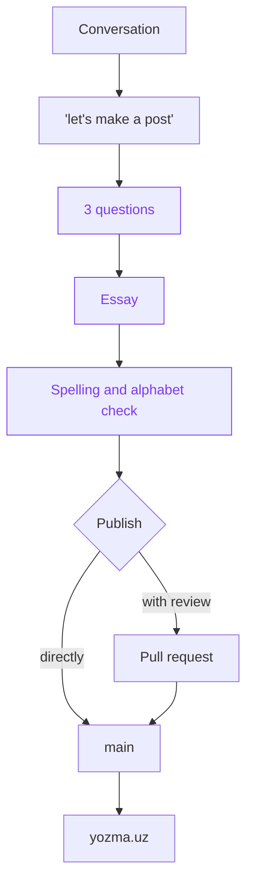

# Yozma

[Yozma](https://yozma.uz) is a small personal blog. Its posts are born from conversations with ChatGPT or Claude: when a chat turns out well, the model interviews the author, writes the post in the author's voice in Uzbek (2026 Latin alphabet), and publishes it to this repository.

## How it works

At the end of a chat the author says "let's make a post of this". The model asks three questions, writes the essay, checks spelling and alphabet, and commits it either straight to `main` or as a pull request. The site rebuilds on every push.



## Post format

Posts live in `posts/<slug>.md`: Markdown with YAML frontmatter.

| Field | Meaning |
| --- | --- |
| `title`, `date`, `description`, `tags` | Basic metadata (`date` is `YYYY-MM-DD`, Asia/Tashkent) |
| `author` | Post author |
| `source` | Model the chat happened with (`claude` or `chatgpt`) |
| `seed` | The author's original thought the post grew from |
| `status` | `draft` or `published` (default `published`) |
| `updated` | Date of the last edit |

Footnotes named `[^ai-N]` are the AI's notes and render as ✦. Each post may contain one mermaid diagram. See [posts/welcome-to-yozma.md](posts/welcome-to-yozma.md) for an example.

## Repo layout

| Path | What is there |
| --- | --- |
| `src/lib/uz` | Alphabet converter, frontmatter conversion, linter, Tahrirchi client |
| `src/lib/posts` | Reading, rendering and metadata of posts |
| `mcp/` | Cloudflare Worker with the MCP server (publishing from chat) |
| `writing/` | Interview, style guide, blacklist, protected words |
| `scripts/` | `yozma:convert` and `yozma:check` CLIs |
| `posts/` | The posts |

## Local development

```bash
pnpm install
pnpm dev            # Next.js dev server
pnpm test           # vitest
pnpm build          # production build
pnpm yozma:check posts/<slug>.md     # lint a post
pnpm yozma:convert <file>            # old alphabet -> new alphabet
```

## MCP server

Run `pnpm install` at the repo root first. `mcp/` is a Cloudflare Worker at `https://mcp.yozma.uz/mcp`. Sign-in is GitHub OAuth, limited to the author's account. Tools:

- `get_guide`: the interview, style guide and blacklist, to read before writing
- `check_uzbek`: convert and lint Markdown, returns errors and warnings
- `convert_alphabet`: convert text to the new alphabet, keeping protected words
- `publish_post`: commit a new post to `main` or open a `post/<slug>` pull request
- `update_post`: edit an existing post

Deploy it (Cloudflare login, KV, GitHub OAuth App, token, secrets, deploy, checks):

```bash
bash mcp/scripts/setup.sh
```

Connect a client to `https://mcp.yozma.uz/mcp`:

- **claude.ai**: Settings, Connectors, Add custom connector.
- **ChatGPT**: Settings, Apps & Connectors (or Plugins), Advanced, Developer mode, add a custom MCP server. Write tools may be unavailable on some plans.
- **Claude Code**: `claude mcp add --transport http yozma https://mcp.yozma.uz/mcp`

## Uzbek alphabet

Posts use the new Latin alphabet from law OʻRQ-1184 (2026): `ö`, `ğ`, `ş`, `ç` instead of `oʻ`, `gʻ`, `sh`, `ch`, and `ʼ` for the apostrophe. The converter skips code, links and protected words (`writing/protected-words.txt`); the linter catches leftover old letters. Spellcheck through [Tahrirchi](https://tahrirchi.uz) is optional and enabled by setting `TAHRIRCHI_API_KEY`.

## License

MIT
