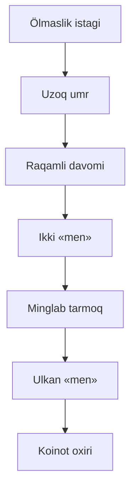

Bu suhbat zerikişdan boşlandi. Menga utopiyalar haqida öylaş yoqadi: hamma narsa mumkin bölsa, nima qilardim. Bu safar savol şunday edi: insoniyatni Kardaşev şkalasi[^1] böyiça II tipga olib çiqiş uçun nima kerak?

## Hokimiyatsiz kuç

Birinçi javobim oddiy edi: global muammolarni hal qila oladigan korporatsiya. Lekin butun insoniyatni boşqarişni xohlamadim. Har bir jamiyat öz madaniyatini va siyosiy tuzumini özi tanlaşi kerak. Kimdir mening tamoyillarim asosida yaşaşni xohlamasa, majburlamayman. Xohlaganlar uçun alohida dunyo quriş mumkin, balki kosmosda.

Keyin vorislik masalasi çiqdi. Korporatsiyani mening fikrlaş tarzimni özlaştirgan AGI boşqaradi, lekin içida demokratiya qoladi. Insoniyat kelajagi bitta sunʼiy intellektning irodasiga boğliq bölmasligi kerak.

Şu yerda suhbat sivilizatsiyadan menga köçdi. Agar AGI meni davom ettirsa, u menmi?

## Ikkita «men»

Avval qatʼiy javob berdim: bir vaqtda ikkita «men» bölişi mumkin emas. Agar bittasi qolsa, u butun masʼuliyatni oladi va menga aylanadi.

Bu fikrni keskin misol bilan tekşirdik[^ai-1]. Mening mukammal nusxam bor, ikkalamizga ham «sen aslisan» deyişgan, xotiralarimiz bir xil. Oldimizda tugma: bosilsa, tizim tasodifan bittamizni yöq qiladi, ikkinçisi hayotni davom ettiradi. Nusxa xotirjam: «Kim yöqolsa ham, men qolaman.» Men esa hozirgi ong oqimim 50% ehtimol bilan töxtaşini bilaman.

Tugmani bosmadim. Öşa darajaga yetgan bölsam, bunday narsalar meni qiziqtirmas edi: ikkalamiz ham mavjud bölib, ikkalamiz ham «men» ekanimizni tan olardik va qarorlarni birga qabul qilardik. Ikkalamizni ham qoldirardim.

Bu birinçi javobimga zid. Lekin fikr aynan şu yerda özgardi: «men» yagona bölişi şart emas.

## Daraxt

Şundan keyin hammasi tez kengaydi.

Beş yuz yildan keyin minglab davomlarim bor deb tasavvur qildik. Biri Quyoş yonida tadqiqot olib boradi, biri boşqa yulduzga ketgan, biri oddiy oilaviy hayot keçiradi, biri esa şunçalik özgarganki, boşlanğiç qaraşlarimga qöşilmaydi. Hammasi bitta odamdan çiqqan va hammasi öşa boşlanğiç hayotni öz ötmişi deb eslaydi. Bunda alohida nusxa emas, butun daraxtning uzluksizligi muhim bölib qoladi[^ai-2]. Bitta tarmoqning ölimi baribir haqiqiy ölim. Lekin bu endi yaxlit «men»ning ölimi emas.

Keyin savol tuğildi: million yildan keyin kimdir şu yozişmani öqisa, menga qanday qaraydi? Mening javobim: öziga qaraganday. Jismonan u emasligini anglasa ham, bu baribir u. Hozirgi odam uçun bu murakkab tuşunça. U esa bizning tuşunçalarimizdan juda uzoqda va unga bu qiyin emas: bu u, faqat juda qadimgi u. Unda ulkan «men»dan boşqa heç narsa qolmagan.

## Sönggi savol

Oxirida ölim baribir qaytib keldi. Agar fizika qonunlari abadiy mavjud bölişga yöl qöymasa, bu ulkan «men» ham koinot bilan birga tugaydi. «Ölişni xohlamayman»dan boşlab, «men»imni şunçalik kengaytirdimki, endi ölim faqat koinot bilan birga keladi.

Men bunday ölimni qabul qilgan bölardim. «Ön yildan keyin ölasan» degan gapga qaraganda bu butunlay boşqaça tuyuladi.

Şu yerda Isaak Asimovning «Sönggi savol» hikoyasi esimga tuşdi[^2]. Balki men ham Sönggi savolga javob topa olarman.

## Oçiq qolgan savol

Suhbat oxirida bitta savol oçiq qoldi: «men»ni kengaytiriş ölimga munosabatni özgartiradimi, yoki biz şunçaki abadiy yaşaş istagining kattaroq şaklini topyapmizmi?

Bu reja emas, fikriy tajriba. Lekin «men» qayerda tugaydi degan savol menga «qanday qilib ölmaslik kerak» degan savoldan qiziqroq tuyuldi.

[^1]: Kardaşev şkalasi: sivilizatsiyani foydalanadigan energiyasi böyiça ölçaş usuli. II tip öz yulduzining deyarli butun energiyasidan foydalanadi.
[^2]: Hikoyada insoniyat milliardlab yillar davomida bitta savolni qayta-qayta beradi: entropiyani orqaga qaytariş mumkinmi?
[^ai-1]: Tugma bilan tajriba ChatGPT bilan muhokamada çiqdi.
[^ai-2]: Daraxt tasviri ChatGPT bilan suhbatda birga şakllandi.
