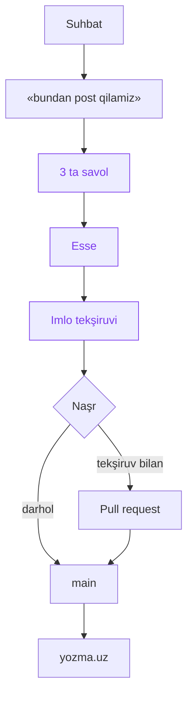

Yozmani 2025-yilda boşlagandim. Ikkita post yozdim, keyin fikrlarni yoziş usulim özgardi: endi ular suhbatlarda şakllanadi.

Biror mavzuni öylab körmoqçi bölsam, ChatGPT yoki Claude bilan gaplaşaman. Baʼzi suhbatlar juda yaxşi çiqadi: savoldan boşlanib, oxirida özimga ham aniq bölmagan fikrga kelaman. Keyin çat yopiladi va hammasi tarixda qoladi.

Buni bitta voqea deb aytolmayman. Şunçaki vaqt ötib, köp yaxşi suhbatlar şunday yöqolganini sezdim.

## Nima özgardi

Yozmaning menga yoqadigan tomoni oddiyligi edi: Markdown fayl yozaman, GitHubʼga commit qilaman, sayt özi yiğiladi. Maʼlumotlar bazasi yöq, server yöq.

Şu oqimni saqladim, faqat boşini almaştirdim. Endi faylni suhbatning özi yozadi.

Suhbat oxirida modelga «bundan post qilamiz» deyman. Model menga uçta savol beradi: asosiy fikr bir gapda, bu qayerdan boşlandi va nimadan şubhalanaman. Bu post ham şu savollar bilan yozildi.

Keyin model matnni birinçi şaxsda, özbek tilida yozadi. Suhbat qaysi tilda bölgani muhim emas. Bu post çiqqan suhbat rus tilida edi.

Imlo Tahrirchi[^1] orqali tekşiriladi. Tahrirchi yangi alifboni hali bilmaydi, şuning uçun matn avval eski yozuvga ögiriladi, tekşiriladi, keyin topilgan xatolar yangi matnga qaytarib boğlanadi[^ai-1].

Oxirida qanday naşr qilişni tanlayman. Yo darhol `main`ga, yo pull request orqali. PRʼda biror joyga izoh qoldirsam, bot matnni tuzatadi va yana tekşiradi.

## Yangi alifbo

Postlar yangi lotin alifbosida yoziladi: `oʻ`, `gʻ`, `sh`, `ch` örniga `ö`, `ğ`, `ş`, `ç`. Alifbo haqidagi qonun 2026-yil oktabrda imzolangan va 2027-yil aprelda kuçga kiradi. Men bir oz erta ötdim.

Bu oddiy almaştiriş emas. «ChatGPT» yoki `fetch` kabi sözlarga tegmaslik kerak, kod bloklari va havolalar özgarmasligi kerak. Konverter şularni hisobga oladi, linter esa qolib ketgan eski harflarni topadi.

## Hozir nima işlaydi

Halol aytganda, hamma qism hali tayyor emas. Sayt, konverter, Tahrirchi bilan tekşiruv va CI işlaydi. Çatga ulanadigan MCP[^2] server[^ai-2] va PRʼdagi bot keyingi bosqiçda. Şuning uçun bu post Claude Codeʼda, şu suhbatning özidan yozildi.

## Bu kimga kerak

Bilmayman. Bu birinçi navbatda özim uçun hobbi. Qiziq mavzularni çat-botlar bilan muhokama qilişga turtki va keyinçalik özim qaytib öqiydigan joy. Kimdir yoki boşqa bir AI agent bu yerdan foydali narsa topsa, yaxşi.

[^1]: Tahrirchi: özbek tili uçun imlo tekşiruvi va tarjima APIʼsi.
[^2]: MCP (Model Context Protocol): modelga taşqi vositalarni ulaş standarti. Yozma uçun bu çatdan töğridan-töğri GitHubʼga post yuboriş imkoniyati.
[^ai-1]: Bu yondaşuv Claude bilan muhokamada çiqdi.
[^ai-2]: Matnni köçirib ötkazmasdan, çatni MCP orqali ulaş variantini Claude bilan birga körib çiqdik.
